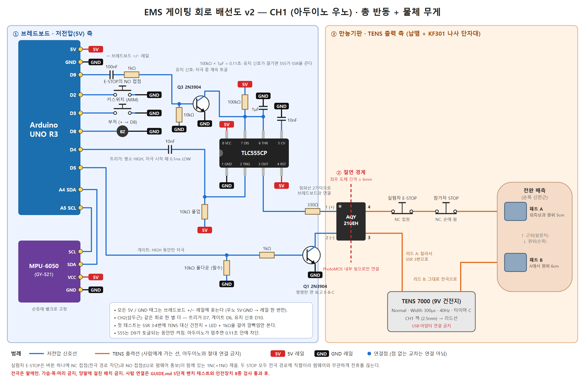

# EMS 근자극 기반 가상 충돌 반동 및 무게감 피드백 시스템

> 사용자의 근육을 액추에이터로 쓰는 햅틱 인터페이스. 상용 저주파 자극기(TENS)의 출력을 절연 게이팅 회로로 제어해, 가상 총을 쏠 때는 손목이 튕기는 **반동**을, 가상 물체를 들 때는 팔이 아래로 끌리는 **무게감**을 만든다.



## 개요

| 항목 | 내용 |
|---|---|
| 분야 | HCI, 피지컬 컴퓨팅, EMS(Electrical Muscle Stimulation) 햅틱 |
| 맥락 | 대학 인터랙티브 시스템 프로토타이핑 과목 프로젝트 (2026 가을) |
| 시연 | ① 총 반동: 손목 신전근 120ms 자극 ② 물체 무게: 손목 신전근 + 삼두근 지속 자극과 시각 지연(pseudo-haptics) |
| 하드웨어 | Arduino Uno, MPU-6050 IMU, TENS 7000 계열(9V, 300µs, 40Hz), AQY210EH PhotoMOS, TLC555 |
| 소프트웨어 | Arduino C++ 펌웨어(논블로킹 상태머신), Processing 4 시연 화면, 체크섬 시리얼 프로토콜 |
| 선행 연구 | Lopes et al. *Impacto* (UIST 2015), *Providing Haptics to Walls & Heavy Objects in VR by Means of EMS* (CHI 2017) |

## 핵심 설계

- **인증 기기 출력단 무개조**: 자극 파형과 전류 제한은 상용 TENS가 맡고, 이 시스템은 "언제 흐르게 할지"만 결정한다.
- **광 절연 게이팅**: PhotoMOS(1.5kV 절연)가 TENS 출력선 한 가닥을 1ms 단위로 개폐한다. PC·아두이노와 인체 사이에 전기적 경로가 없다.
- **5겹 안전 구조**: 기기 노브 물리 스토퍼, 전극 경로 직렬 비상정지 2개, 유지 신호가 끊기면 0.05초 안에 차단하는 555 하드웨어 감시, 펌웨어 예산·하트비트·워치독, 참가자 스크리닝 절차.
- **두 가지 자극 모드**: 반동은 60~250ms 단발(`$T`), 무게는 PC가 100ms마다 재전송하는 동안 최대 5초 지속(`$W`).
- **무게 단계 표현**: 강도 대신 채널을 쌓는다(없음 / 손목 / 손목+삼두근). 화면 속 손이 실제 팔보다 늦게 따라오는 시각 지연을 함께 써서 무게 범위를 넓힌다.

## 저장소 구성

```
├── README.md                                   설계서 (이 문서)
├── SUMMARY.md                                  진행 요약 (결정·검증·다음 단계)
├── GUIDE.md                                    완주 가이드 (단계별 절차와 통과 기준)
├── BRIEF.md                                    프로젝트 브리핑 (결정 근거 요약)
├── references.md                               관련 논문 목록
├── docs/wiring_ch1_uno.png / .svg              CH1 배선도 v2
├── docs/breadboard_830.png / BREADBOARD.md     830홀 브레드보드 실물 배치도 + 꽂는 위치 목록
├── docs/breadboard_830_simple.png / BREADBOARD_simple.md   간소화판 (키스위치·부저·실험자 E-STOP 생략)
├── docs/pad_placement.png                       전극 패드 붙이는 위치
├── docs/probe_a20_a21.png                       멀티미터로 PhotoMOS 확인하는 법
├── firmware/ems_recoil/ems_recoil.ino          Arduino Uno 펌웨어 v2 (반동 + 무게)
├── firmware/ems_recoil_esp32/                  ESP32 펌웨어 v2.1 (우노와 같은 로직, KA는 GPIO32/33, VR 단계용)
├── processing/EMSRecoilSim/EMSRecoilSim.pde    시연 화면 (총 / 들기 / 벽 모드)
└── tools/                                      시리얼 자동 검사, 배선도 생성 스크립트
```

## 진행 상황

- [x] 설계 (회로, 안전 구조, 프로토콜, 매핑)
- [x] 펌웨어 v1 우노 업로드 및 시리얼 응답 검증
- [x] TENS 기기 단독 확인 (Width 300µs, 근수축 체감)
- [x] 펌웨어 v2 (반동 + 무게), 시간 계산 버그 수정
- [x] 브레드보드 회로 조립 (간소화판), 자동 점검 12/12, CH1 PhotoMOS 확인
- [x] Processing 공 2개 블라인드 무게 비교 모드
- [ ] 벤치 검사 (저항 부하, 안전장치 9종)
- [ ] 본인 캘리브레이션, 시연, 발표

## 안전 고지

이 저장소는 교육용 연구 프로토타입 기록이다. 전기 근육 자극은 심장박동기·이식 전자기기 사용자, 뇌전증, 심장질환, 임신 중인 사람에게 금기이며, 전극은 팔에만 부착한다(가슴·목·머리, 양팔에 걸친 배치 금지). 상용 자극기의 출력단을 개조하지 말고, 사람에게 연결하기 전에 GUIDE.md의 벤치 검사를 모두 통과해야 한다. 이 자료를 따라 해서 생긴 결과에 대한 책임은 사용자에게 있다.

---

# 기술 설계서

## 1. 하드웨어 회로 & 안전 아키텍처

### 1.1 개조 방식 비교

| 방식 | 원리 | 지연 | 시간 정밀도 | 위험/단점 | 판정 |
|---|---|---|---|---|---|
| A. 버튼 인터셉트 | 기기 버튼 패드 양단에 PC817 병렬, 아두이노가 "누름" 흉내 | 기기 펌웨어 램프업 200ms~1s | 낮음 (버튼 1회 = 1단계) | 출력 회로 무접촉이라 안전. 그러나 50~200ms 임펄스 불가 | 폴백 |
| **B. 출력 라인 게이팅** | 기기는 고정 강도로 계속 동작, 전극 리드 한 가닥에 PhotoMOS SSR 직렬 삽입, 아두이노가 개폐 | **≤1ms** | **1ms 단위** | 일부 기기의 패드 이탈 감지(오픈로드) → 더미 로드로 해결 | **채택** |
| C. 강도 포텐쇼미터 치환 | 기기 내부 강도 가변저항을 디지털 포텐쇼미터(MCP41xx)로 교체 (openEMSstim 방식) | 수 ms | 강도까지 제어 | 기기 분해·납땜, 기기별 회로 분석 필요, 학부 데모엔 과함 | 고급 옵션 |

**원칙: 기기의 출력단(승압 트랜스, 정전류 회로)은 절대 손대지 않는다.** 인증받은 기기의 전류 제한·파형 안전성을 그대로 이용하고, 우리는 "언제 흐르게 할지"만 결정한다.

### 1.2 기기 선정

- **배터리(9V 또는 AA) 구동 기기만** 사용. 상용 AC 어댑터형 금지 (PC 접지와 인체 사이 경로 차단).
- 아날로그 강도 다이얼 + 연속 모드(30~60Hz, 펄스폭 200~300µs)가 있는 TENS 유닛이 가장 좋다 (예: TENS 7000 류, KC 인증 2채널 저주파 치료기). 다이얼은 물리 스토퍼로 상한 고정이 가능하다.
- 버튼형 국산 저주파 마사지기도 가능. 단, (1) 모드를 "연속/지압"류 고정 주파수로 두고 "두드림/주무름" 같은 버스트 모드는 피할 것, (2) 패드 이탈 감지로 강도가 0으로 리셋되는지 먼저 확인 (1.4의 더미 로드로 대응).
- 전극: 40×40mm 또는 50×50mm 하이드로겔 패드, 2.0mm 핀 리드선 1세트 여분 (한 가닥을 잘라 SSR을 끼운다).

### 1.3 부품 목록 (CH1 기준)

| 구분 | 부품 | 수량 | 비고 |
|---|---|---|---|
| MCU | Arduino Uno R3 (또는 Nano, optiboot 부트로더) | 1 | 구형 Nano 부트로더는 WDT 리셋 루프 문제 있음 |
| 센서 | MPU-6050 (GY-521) | 1 | 손등에 고정, I2C 케이블 15cm 이하 |
| 절연 스위치 | **Panasonic AQY210EH** PhotoMOS (350V/130mA, 1 Form A) | 1~2 | 대체: Omron G3VM-351C. 폴백: 5V 리드릴레이 Coto 9007-05-01 + 1N4148 |
| 하드웨어 타이머 | NE555, 270kΩ, 1µF (필름/탄탈), 10nF ×2, 10kΩ | 1세트 | 최대 자극 창 ≈ 0.3s |
| 드라이버 | 2N3904, 1kΩ, 10kΩ(풀다운), 330Ω | 1세트 | |
| 비상정지 | 22mm 머쉬룸 E-STOP (1NC + 1NO) | 1 | NC: 전극 경로 직렬, NO: D2 |
| 참가자 정지 | NC 푸시버튼 (손에 쥐는 형) | 1 | 전극 경로 직렬 |
| 아밍 | 키스위치 (또는 토글) | 1 | D3 |
| 표시 | 부저, LED | 1 | D8, D13 |
| 더미 로드 (옵션) | 1kΩ 2W + AQY210EH | 1 | 패드 이탈 감지 기기용 |
| 절연 (옵션) | USB 아이솔레이터 (ADuM3160 보드) | 1 | 노트북을 어댑터에 꽂고 시연할 때 |
| 기판 | 만능기판 | 1 | 고전압 측은 브레드보드 금지 |

### 1.4 회로도 (CH1, v1 — 현재 회로는 docs/wiring_ch1_uno.png와 docs/breadboard_830.png)

```
[PC/USB 측: 아두이노 GND 기준]                  ║ 절연 경계 (PhotoMOS 1.5kVrms, 연면 ≥6mm) ║   [EMS 측: 배터리 플로팅, GND 연결 금지]
                                                ║
 +5V ──┬──────────────┬─────────────┐           ║
       │             270k        8   4          ║
       │              │       ┌──┴───┴──┐       ║
       ├──10k─┐       ├──6/7──┤  NE555  │3──────╫──330Ω──► pin1(+) ┌──────────┐ pin4 ──► [E-STOP NC] ──► [참가자 STOP NC] ──► 전극 A (근위)
       │      │       │       │         │       ║                   │ AQY210EH │
 D4 ──10nF────┴──2────┘   ┌──5│      1  │       ║   pin2(−) ◄───────┤          │ pin3 ◄──── EMS CH1 리드 A
   (평소 HIGH, 시작 시  1µF   10nF        │       ║      │            └──────────┘
    100µs LOW 펄스)     │      │         │       ║   Q1 2N3904 (C)
                       GND    GND       GND      ║      B ◄─1k─ D5 ─┬─ 10k ─ GND      EMS CH1 리드 B ────────────────────────► 전극 B (원위)
                                                ║      E ─ GND      (풀다운 필수)
```

동작: SSR LED는 **(555 출력 HIGH) AND (D5 HIGH)** 일 때만 켜진다.
- D5 = 실제 자극 길이/듀티 제어 (펌웨어).
- 555 = 트리거 후 T = 1.1·R·C = 1.1 × 270kΩ × 1µF ≈ **0.30s** 동안만 HIGH. 아두이노가 D5를 HIGH로 물고 죽어도 0.3s 후 강제 차단.
- D4 → 10nF 결합 커패시터 → 555 pin2 (10k 풀업). D4가 LOW로 고착돼도 스파이크 1회만 통과하므로 재트리거 불가.
- 저항값: SSR LED I_F = (5.0 − 1.25 V) / 330Ω ≈ **11mA** (AQY210EH 권장 5~20mA, 최대 50mA). Q1 베이스 (5 − 0.7)/1k ≈ 4.3mA → 포화 충분.
- 초기 테스트 시 555를 건너뛰려면 pin3 대신 +5V를 330Ω에 임시 연결(점퍼). 최종 데모는 반드시 555 경유.

**출력 측 배선**: 여분 리드선의 A 가닥을 중간에서 자르고 SSR 출력 핀(3번·4번) 사이에 삽입한다. AQY210EH는 DIP-4이며 1번 LED+, 2번 LED−, 3·4번 출력이다. B 가닥은 그대로 전극 B로 간다. 리드선은 꼬아서 USB/IMU 케이블과 떨어뜨린다. **EMS 측 어느 선도 아두이노 GND에 닿으면 안 된다.**

**더미 로드 (패드 이탈 감지 기기용, v1 설계)**: v2에서 D9·D10은 유지 신호(KA) 핀이므로, 더미 로드가 필요해지면 D11·D12 같은 빈 핀을 쓴다. 지금 쓰는 TENS 7000은 패드 이탈 감지가 없어 필요 없다. 두 번째 AQY210EH를 리드 A(기기 쪽)와 리드 B 사이에 1kΩ 2W와 직렬로 놓고, LED는 D9 → 330Ω으로 구동. ARMED 상태에서 자극 중이 아닐 때 D9 HIGH(더미 로드 연결), 자극 시 D9 LOW 후 1ms 뒤 D5 HIGH(break-before-make). 리셋 시 D9 LOW → 기기가 오픈로드를 감지해 강도 0으로 떨어지므로 실패 방향도 안전하다.

**폴백 A안 (PC817 버튼 인터셉트)**: PC817 V_CEO 35V, 단방향이라 ±100V 양극성 TENS 출력을 게이팅할 수 없다. 버튼 패드(약 3V, <1mA)에만 쓴다.
```
 D9 ──330Ω──► PC817 pin1(A)     pin4(C) ──► 버튼 패드 (전압 높은 쪽, 풀업)
              PC817 pin2(K)─GND pin3(E) ──► 버튼 패드 (기기 GND 쪽)
```
I_F ≈ 11.5mA, CTR ≥ 50% → I_C ≥ 5mA로 버튼 신호 전류를 충분히 흡수. 누름 시간 80~150ms를 펌웨어에서 준다.

### 1.5 절연·노이즈 대책

- PC(USB 접지) ↔ 아두이노 ↔ [PhotoMOS 광 경계] ↔ 배터리 EMS ↔ 인체. 광 경계와 기기 배터리의 이중 플로팅으로 PC 접지가 인체와 연결될 경로가 없다.
- 만능기판에서 LED 측과 출력 측 패턴 간격 ≥ 6mm, 사이에 다른 부품 두지 않기.
- TENS 펄스가 IMU I2C 선에 유도되면 읽기 오류가 난다. IMU 케이블은 짧게, 꼬임선, 4.7kΩ 풀업, 필요 시 페라이트 코어.
- 노트북은 배터리로 시연. 어댑터를 써야 하면 USB 아이솔레이터.

### 1.6 안전 계층 (독립적인 5겹)

| 계층 | 수단 | 무엇이 망가져도 동작하는가 |
|---|---|---|
| L0 기기 고유 | 인증 기기 출력단 무개조, 강도 다이얼 **물리 스토퍼(Safety Clamp)** 로 캘리브레이션 상한 고정, 배터리 구동 | 우리 회로 전체 |
| L1 하드웨어 차단 | 전극 경로에 실험자 E-STOP NC + 참가자 STOP NC 직렬. PhotoMOS는 무전원 시 OPEN(fail-open). D5 10k 풀다운 | MCU, PC, 펌웨어 |
| L2 하드웨어 시간 제한 | 555 모노스테이블 0.3s 창 AND 게이트 | 펌웨어 고착 |
| L3 펌웨어 | MAX_PULSE 250ms, MIN_GAP 300ms, 10초 창 듀티 30%, 분당 40회, 무게 5초·휴식 2초·1분 누적 30초·재들기 간격 0.5초, PC 하트비트 1s 타임아웃, WDT 250ms, ARM 키스위치, ESTOP 인터럽트 즉시 차단, FAULT 래치(`$R`로만 해제) | PC 소프트웨어 |
| L4 절차 | 스크리닝(심박조율기/ICD, 뇌전증, 임신, 심장질환, 피부손상), 구두 동의, 전극은 **전완 배측에만**(흉부·경부·두부·양팔 교차 금지), 발표자 본인 선시연, 참가자당 최대 40회 | 사람의 판단 |

### 1.7 전극 위치 (손목 신전)

- 팔을 회내(손바닥 아래) 상태로 테이블에 얹고 손은 테이블 끝 밖으로.
- 전극 A(근위): 외측상과(lateral epicondyle)에서 원위 약 5cm, 요측 전완 배측 ECRB/ECRL 근복 위.
- 전극 B(원위): A에서 원위 6cm, 같은 근육 라인.
- 손가락이 손목보다 더 펴지면(EDC 우세) 두 패드를 요측으로 1cm 이동. 척측 편위가 나오면 반대로.

---

## 2. 양방향 시리얼 프로토콜

### 2.1 물리·프레이밍

- 115200 8N1. 텍스트 라인, NMEA 스타일: `$<BODY>*<HH>\n`, HH = BODY 전체 바이트의 XOR (2자리 16진).
- 센서 라인 약 65바이트 × 100Hz ≈ 6.5kB/s (대역 57%). 여유가 필요하면 250000 baud (16MHz에서 오차 0%).
- Firefly/Processing 모두 텍스트 파싱이 쉽고, 오실로스코프 없이 시리얼 모니터로 디버깅 가능.

### 2.2 MCU → PC

| 패킷 | 형식 | 주기 |
|---|---|---|
| 센서 | `$S,<seq>,<roll>,<pitch>,<gx>,<gy>,<gz>,<ax>,<ay>,<az>,<dist_mm>,<state>*HH` | 100Hz |
| ACK | `$K,T,<ch>,<dur>,<duty>*HH` / `$K,A,1*HH` / `$K,X*HH` / `$K,R*HH` | 명령 응답 |
| 오류 | `$E,<code>,<msg>*HH` | 발생 시 |
| 부팅 | `$I,EMS_RECOIL,v1,MAXP=250,GAP=300*HH` | 1회 |

- seq: 0~65535 순환. PC에서 건너뜀 감지로 패킷 유실률 측정.
- roll/pitch: 도, 소수 1자리 (상보필터). gx~gz: deg/s 정수. ax~az: g × 100 정수. dist_mm: ToF(VL53L1X) 장착 시 거리, 미장착 -1.
- state: 0 IDLE, 1 ARMED, 2 자극 중, 9 FAULT. (v1의 3 COOLDOWN은 v2에서 없어졌다. 간격 제한은 채널별로 펌웨어 안에서만 처리)
- 오류 코드: 1 ESTOP, 2 ARM_SWITCH_OFF, 3 HEARTBEAT_LOST, 4 NOT_ARMED, 5 BUDGET, 6 BAD_CS, 7 IN_FAULT, 8 ESTOP_STILL_PRESSED, 9 UNKNOWN, 10 BAD_CH, 11 HOLD_REST / HOLD_LIMIT (무게 5초 도달 또는 휴식 중), 12 BUSY (그 채널이 이미 자극 중), 13 HOLD_BUDGET (무게 1분 누적 30초 초과), 14 TOO_SOON (반동 간격 300ms 미만).
- `$W` 추가 규칙 (v2.1): 내려놓은 뒤 0.5초 안의 재요청은 조용히 무시되고, 다음 재전송에서 켜진다.

예: `$S,1042,3.2,-27.5,12,-410,5,15,-8,97,-1,1*4C`

### 2.3 PC → MCU

| 패킷 | 형식 | 의미 |
|---|---|---|
| 트리거 | `$T,<ch>,<dur_ms>,<duty%>,<env>*HH` | ch 1/2, dur 10~250 (초과 시 클램프), duty 10~100, env 0 평탄 / 1 감쇠(100%→duty) |
| 하트비트 | `$H*HH` | 200ms 주기. 1s 끊기면 자동 DISARM |
| 아밍 | `$A,1*HH` / `$A,0*HH` | 키스위치 ON + 소프트 아밍 둘 다 필요 |
| 정지 | `$X*HH` | 즉시 게이트 OFF, IDLE |
| 복구 | `$R*HH` | FAULT 해제 (E-STOP 풀린 뒤에만) |

예: `$T,1,120,100,0*57` (CH1, 120ms, 100%, 평탄)

### 2.4 유실 방지·지연 최소화 전략

- **체크섬 필수 + 실패 패킷 폐기**: 재전송 대신 폐기. 센서는 10ms 뒤 다음 패킷이 오고, 트리거는 ACK 미수신 시 PC가 재전송(불응기 내면 펌웨어가 거부하므로 이중 자극 없음).
- **하트비트를 별도 스레드/draw에서 5Hz**: 자극 명령이 없어도 링크 생존 증명. 유효 패킷은 모두 하트비트로 인정.
- **PC 수신은 `bufferUntil('\n')` + `serialEvent`** 에서 처리하고, 충돌 판정도 거기서 한다. draw()의 16ms 프레임 대기에 묶이지 않는다.
- **펌웨어는 바이트 단위 논블로킹 파서**, `$`에서 리셋, 64B 버퍼 상한. `delay()` 전무, `sscanf`만 사용.
- **지연 예산**

| 단계 | 지연 |
|---|---|
| IMU 샘플 주기 | 0~10ms |
| 센서 라인 전송 (65B @115200) | ≈6ms |
| PC 파싱·판정 | <1ms |
| 트리거 라인 전송 (20B) | ≈2ms |
| 펌웨어 루프 폴링 | <1ms |
| PhotoMOS 턴온 | ≤1ms |
| 전기-기계 지연 (근육 반응) | 40~80ms |
| **합계** | **≈50~100ms** |

근육 자체의 지연이 지배적이므로 소프트웨어에서 **time-to-contact 예측 트리거**(3.1)로 50ms 선행한다.

---

## 3. 소프트웨어 파이프라인 & 알고리즘

### 3.1 파라메트릭 매핑

기호: v_c 충돌 속도(가상 단위/s), d 관통 깊이(0..1 정규화), 재질 상수 (s_mat, D_mat, env).

```
v_n  = clamp(v_c / v_max, 0, 1)                         v_max = 3.0 (캘리브레이션에서 조정)
T    = T_min + (T_max − T_min) · v_n^γ                  T_min = 60ms, T_max = 220ms, γ = 0.7 (지각 압축)
T'   = T · s_mat                                        강철 1.0 / 고무 1.3 / 폼 1.6  → 펌웨어에서 250ms 클램프
D    = clamp(D_mat + 30 · clamp(d / d_max, 0, 1), 10, 100) %    D_mat: 강철 100 / 고무 70 / 폼 50, d_max = 0.2
env  = 0 (강체: 평탄)  |  1 (연체: 100% → D 로 선형 감쇠)

트리거:  ¬inside ∧ ( d ≥ 0  ∨  ( v_c > v_min ∧ (−d)/v_c < τ_lead ) ) ∧ (t − t_last > 300ms)
         v_min = 0.2, τ_lead = 50ms   (전기-기계 지연 보상)
탈출:    inside ∧ d < −0.03           (히스테리시스, 벽 경계에서 채터링 방지)
```

- 왜 지속시간이 주 변수인가: 상용 기기는 진폭을 우리가 바꿀 수 없다. 짧은 펄스열(60ms)은 "톡" 치는 반동, 200ms는 "밀려나는" 반동으로 지각된다.
- 듀티 변조(50Hz on/off 게이팅)는 기기 펄스 일부를 걸러 평균 근력을 낮춘다. 기기 펄스 주파수를 60Hz 이상으로 두면 비트(beat) 현상이 덜하다.
- (미구현. 지금 스케치에서 1/2/3 키는 모드 전환이고 벽 모드는 듀티 100% 고정이다. 넣는다면 다른 키를 쓴다.) 재질 3종은 데모에서 "강철 벽 / 고무 / 스펀지"로 전환. 같은 속도에서 자극 봉투(envelope)가 달라지는 것을 참가자가 구별하면 설득력이 크게 오른다.

### 3.2 Processing 스켈레톤

전체 코드: `processing/EMSRecoilSim/EMSRecoilSim.pde`. 핵심은 (1) serialEvent에서 체크섬 검증 후 물리 갱신, (2) 예측 트리거, (3) 매핑 함수, (4) 하트비트.

```java
void updatePhysics() {
  int t = millis(); float dt = (prevT == 0) ? 0.01 : (t - prevT) / 1000.0; prevT = t;
  float x = constrain(map(pitch, PITCH_MIN, PITCH_MAX, 0, 1), 0, 1);
  handX = lerp(handX, x, 0.5);
  handV = (handX - prevX) / max(dt, 1e-3); prevX = handX;
  float depth = handX - WALL_X;
  boolean predicted = (handV > 0.2) && (depth < 0) && ((-depth) / handV < LEAD_S);
  if (!inside && (depth >= 0 || predicted)) {
    inside = true;
    if (t - lastTrig > REFRACT_MS) { fire(handV, max(depth, 0)); lastTrig = t; }
  } else if (inside && depth < -0.03) inside = false;
}
void fire(float v, float depth) {
  float vn  = constrain(v / V_MAX, 0, 1);
  int   dur = round((T_MIN + (T_MAX - T_MIN) * pow(vn, GAMMA)) * MAT[mat][2] / 10.0);
  int   duty = constrain(round(MAT[mat][0] + 30 * constrain(depth / 0.2, 0, 1)), 10, 100);
  send("T,1," + dur + "," + duty + "," + MAT[mat][1]);
}
synchronized void send(String body) { port.write("$" + body + "*" + hex(xor(body), 2) + "\n"); }
```

### 3.3 Grasshopper + Firefly 구성안

```
[Firefly Serial Read  COM, 115200, Timer 10ms]
   → [Text Split ',']
   → [GhPython: '$'..'*' 추출, XOR 체크섬 검증, seq 갭 카운트]
   → pitch → [Remap −50..50 → 0..1] → [Point on X axis]  (손 커서)
   → [Mesh Closest Point] 또는 [Brep Inclusion] → depth (부호 있는 거리)
   → [Firefly Buffer(2) / Data Recorder] → v = Δx / Δt
   → [Expression]  dur = 60 + 160·clamp(v/3,0,1)^0.7 ,  duty = D_mat + 30·clamp(depth/0.2,0,1)
   → [Stream Gate: ¬inside ∧ (depth ≥ 0 ∨ ttc < 0.05)]
   → [Concatenate "T,1," dur "," duty ",0"] → [GhPython XOR] → "$…*HH\n"
   → [Firefly Serial Write]
[Timer 200ms] → "$H*.." → [Firefly Serial Write]
```
주의: Grasshopper 솔브는 20~30Hz라 30~50ms가 추가된다. 권장 구성은 **Processing이 센서 수신과 트리거를 담당**하고, 손 위치를 UDP(gHowl/Firefly UDP)로 Rhino에 흘려 3D 시각화만 Grasshopper가 맡는 것이다. Grasshopper 단독으로 가야 한다면 GhPython에서 `System.IO.Ports.SerialPort`를 별도 스레드로 열어 트리거를 직접 쓰는 편이 Firefly Write보다 빠르다.

### 3.4 아두이노 펌웨어 핵심

전체 코드: `firmware/ems_recoil/ems_recoil.ino` (Uno 컴파일 확인: 플래시 49%, RAM 49%). 상태머신 IDLE → ARMED → STIM → COOLDOWN, 어느 상태에서든 FAULT.

```cpp
void loop() {
  wdt_reset();
  uint32_t now = millis();
  readSerial();
  if ((estopFlag || digitalRead(PIN_ESTOP) == LOW) && state != ST_FAULT) enterFault(1);
  if (state != ST_FAULT && state != ST_IDLE && digitalRead(PIN_ARM) == HIGH) { gatesOff(); state = ST_IDLE; }
  if ((state == ST_ARMED || state == ST_STIM) && now - lastHeartbeat > HEARTBEAT_TO_MS) { gatesOff(); state = ST_IDLE; }
  if (state == ST_STIM) {
    uint32_t el = now - cur.t0;
    if (el >= cur.dur) { gatesOff(); lastStimEnd = now; state = ST_COOL; }
    else {
      uint8_t d = cur.duty;
      if (cur.env == 1) d = 100 - (uint32_t)(100 - cur.duty) * el / cur.dur;
      bool on = (d >= 100) || ((el % MOD_PERIOD_MS) < (uint32_t)MOD_PERIOD_MS * d / 100);
      digitalWrite(cur.ch == 2 ? PIN_GATE2 : PIN_GATE1, on ? HIGH : LOW);
    }
  } else if (state == ST_COOL && now - lastStimEnd >= MIN_GAP_MS) state = ST_ARMED;
  if (now - lastSensor >= 10) { lastSensor = now; sensorTick(); }
}
```

시작 순서: `setup()` 첫 줄에서 게이트 OFF → WDT 250ms 활성 → 리셋되면 핀이 Hi-Z가 되고 외부 10k 풀다운이 OFF를 보장.

---

## 4. 발표 데모 전략 & 학술적 소명

### 4.1 포지셔닝 문장

> "본 시스템은 외골격 없이 사용자의 근육 자체를 액추에이터로 사용하는 **EMS 기반 힘 피드백(force feedback)** 을 가상 충돌 물리량(속도·관통 깊이·재질)에 파라메트릭하게 매핑하고, 5겹 하드웨어·펌웨어 인터록 위에서 개인별 지각 캘리브레이션을 거쳐 구동하는 인터랙티브 프로토타입이다."

키워드 (슬라이드 제목/태그로 반복 노출): Electrical Muscle Stimulation (EMS) · Force Feedback without Exoskeleton · Proprioceptive Feedback · Body as Output Device / Actuated Body · Human-Computer Integration · Involuntary Movement & Sense of Agency · Wearable Haptics · Latency-critical Closed Loop · Perceptual Calibration (sensory / motor threshold) · Safety Interlock · Informed Consent.

용어 주의: "Passive Haptics"(Insko 2001)는 물리 소품으로 촉감을 주는 기법이라 이 프로젝트와 반대 개념이다. **Active / actuated haptics, muscle-propelled force feedback** 으로 쓰고, 비교 슬라이드에서 passive haptics·진동 피드백과 대비시킨다.

### 4.2 레퍼런스 (슬라이드 인용용)

- Lopes, Ion, Baudisch. **Impacto: Simulating Physical Impact by Combining Tactile Stimulation with Electrical Muscle Stimulation.** UIST 2015. ← 가장 직접적 선행연구. 차별점: 우리는 충돌 물리량→자극 봉투 매핑과 재질 구분, Rhino 파이프라인.
- Lopes, Baudisch. Muscle-Propelled Force Feedback. CHI 2013.
- Lopes, You, Cheng, Marwecki, Baudisch. Providing Haptics to Walls & Heavy Objects in VR by Means of EMS. CHI 2017.
- Lopes, You, Ion, Baudisch. Adding Force Feedback to Mixed Reality Experiences and Games using EMS. CHI 2018.
- Lopes, Baudisch. Immense Power in a Tiny Package: Wearables Based on EMS. IEEE Pervasive Computing 2017.
- openEMSstim (Lopes 외, GitHub PedroLopes/openEMSstim): 의료 인증 EMS 기기를 디지털 포텐쇼미터로 제어하는 오픈 하드웨어. "인증 기기 출력단 무개조" 원칙의 근거.
- Tamaki, Miyaki, Rekimoto. PossessedHand. CHI 2011.
- Kruijff, Schmalstieg, Beckhaus. Using Neuromuscular Electrical Stimulation for Pseudo-Haptic Feedback. VRST 2006.
- Pfeiffer, Dünte, Schneegass, Alt, Rohs. Cruise Control for Pedestrians. CHI 2015.
- Kasahara, Nishida, Lopes. Preemptive Action: Accelerating Human Reaction using EMS Without Compromising Agency. CHI 2019. ← 예측 트리거·지연 논의의 근거.
- Knibbe, Alsmith, Hornbæk. Experiencing Electrical Muscle Stimulation. IMWUT 2018. ← 수용성·불쾌감 논의.
- Mueller 외. Next Steps for Human-Computer Integration. CHI 2020. ← 상위 프레임.
- Insko. Passive Haptics Significantly Enhances Virtual Environments. 2001. ← 용어 대비용.

### 4.3 평가 설계 (한 슬라이드)

- 조건: 시각만 / 진동(CH2에 ERM 모터) / EMS.
- 측정: (객관) IMU 피크 각속도·반동 각도, 트리거→반응 지연; (주관) 충돌 실재감 7점 Likert, 불쾌감, 통제감(agency).
- 예상 결과 그래프 틀을 미리 그려두고 데모 후 실측치를 끼워 넣는다.

### 4.4 간이 캘리브레이션 시나리오 (참가자당 약 5분)

| 단계 | 시간 | 절차 | 기록 |
|---|---|---|---|
| 0 스크리닝 | 30s | 심박조율기/ICD, 뇌전증, 임신, 심장질환, 팔 피부손상·금속 임플란트 → 제외. 구두 동의, 참가자 STOP 버튼 쥐어주고 눌러보게 함 | 체크리스트 |
| 1 부착 | 60s | 알코올 스왑, 건조하면 물 한 방울. 1.7 위치에 패드 A/B. 팔 회내로 테이블, 손은 끝 밖 | 사진 |
| 2 감각 역치 S | 30s | 강도 0에서 [T] 100ms 테스트 펄스, 1단계씩 상승, "느껴짐" 최소 레벨 | S |
| 3 운동 역치 M | 30s | 손목이 눈에 띄게 젖혀지는 최소 레벨 | M |
| 4 편안 최대 C | 30s | 불편 직전 레벨. **운용 강도 = M + 0.3·(C − M)**, C 초과 금지. 다이얼 스토퍼 고정 | C, 운용값 |
| 5 시간 스케일 | 60s | 60 / 120 / 200ms 각 2회, IMU 피크 gy 기록 → V_MAX, T_MAX 조정 (반동이 과하면 T_MAX 하향) | gy 피크 |
| 6 리허설 | 30s | 느리게 3회, 빠르게 3회 벽 충돌. 재질 1/2/3 구별 확인 | 주관 코멘트 |

### 4.5 현장 변수와 대응

| 변수 | 증상 | 대응 |
|---|---|---|
| 피부 저항 (건조, 털, 각질) | 같은 레벨에서 반응 없음 또는 따가움 | 스왑 후 물/젤, 패드 밀착 2분 대기 후 재측정. 매 참가자 새 패드 |
| 패드 노후 | 강도 급변, 국소 따가움 | 패드는 소모품, 데모당 새것 |
| 위치 편차 | 손가락 신전·척측 편위 | 패드 1cm 요측/척측 이동 후 M 재측정 |
| 긴장·자발 수축 | 반동이 작음 | "손목 힘 빼세요", 팔 받침 확인 |
| 피로 | 반동 감소 | 참가자당 40회 상한, 10분마다 M 재확인 |
| 링크 끊김 | 하트비트 타임아웃 DISARM | 정상 동작. `$A,1` 재아밍만 하면 됨 |
| 기기 오픈로드 리셋 | 트리거 시 강도 0 | 더미 로드 회로 (1.4) |

### 4.6 데모 진행 순서

1. 안전 슬라이드 먼저 (5겹 인터록 그림, 제외 기준). 심사자 신뢰 확보.
2. 발표자 본인 시연: 느린 충돌 → 빠른 충돌 → 재질 3종. 화면에 IMU 각속도 실시간 그래프.
3. 사전 캘리브레이션한 참가자 1~2명. 즉석 지원자는 캘리브레이션 5분을 확보할 때만.
4. E-STOP을 눈에 띄게 두고, 한 번은 의도적으로 눌러 차단을 보여준다.
5. 백업: 시연 영상, CH2 진동 모터로 파이프라인 동작 증명, 예비 9V 배터리·패드, 노트북 배터리 구동.

---

## 5. 확장 로드맵: 상체 웨어러블

최종 목표는 상체 전반의 EMS 웨어러블이며, 무게감은 관절마다 길항근을 자극해 만든다. 현재 회로와 프로토콜은 그대로 두고 아래 규칙만 지킨다.

### 5.1 채널 지도

| 관절 | 자극 근육 | 만드는 감각 | 우선순위 |
|---|---|---|---|
| 손목 | 신전근 (ECRL/ECRB) | 충돌 반동 | 1 (이번 과목) |
| 팔꿈치 | 삼두근 | 들어올릴 때 무거움 | 2 (이번 과목) |
| 팔꿈치 | 이두근 | 밀 때 저항, 당겨짐 | 3 |
| 어깨 | 후면 삼각근 | 앞으로 뻗을 때 무거움 | 4 |
| 어깨 | 전면 삼각근 | 뒤로 밀림 | 5 |
| 손목 | 굴곡근 (FCR) | 잡아채임 | 6 |

### 5.2 확장 규칙

- 채널 카드 = TLC555 + PhotoMOS + 드라이버 1세트, ESP32 GPIO 2개(TRIG, GATE). 8채널까지 ESP32 한 개.
- 자극원은 TENS 7000 1대당 2채널. 4채널 = 2대, 8채널 = 4대. 기기별 독립 플로팅.
- 펌웨어 예산은 전 채널 합산. 같은 관절의 길항근 쌍은 동시 발화 금지.
- 프로토콜 채널 번호 1~16, 호스트에서 근육 이름으로 매핑.
- 3kg 상당 무게감: 손목만으로는 어떤 기기로도 어려움(MVC 25~50%). 삼두근·후면 삼각근 길항근 자극 + 시각 클램핑으로 지각된 무게를 만든다 (Lopes 2017 구조).

### 5.3 상체 확장 시 안전 한계

- 한 채널의 두 전극은 같은 근육 위 10cm 이내. 채널 간 전극 공유 금지.
- 흉부·경부·두부 전극 금지. 전류 경로가 몸통을 가로지르는 배치 금지. 대흉근 제외.
- 다접점 E-STOP(4NC 이상) 하나로 모든 기기의 전극 경로를 동시에 끊는다.

### 5.4 벤치 측정 (기기 확정용, 사람 없이)

1. 부하 500Ω / 1kΩ / 2kΩ (1W). 측정은 오실로스코프 또는 피크 검출기(1N4148 + 100nF + 1MΩ) + 멀티미터. 아두이노 GND와 절대 연결하지 않는다.
2. N 모드, 펄스 폭 최대, 50Hz, 타이머 C. 노브 3 / 6 / 10에서 각 부하의 피크 전압 기록, I = V/R.
3. SSR 게이팅 보드를 끼우고 반복. 피크 동일, 100ms 트리거에 50Hz 펄스 5개 통과 확인.
4. openEMSstim 감쇠단 사용 시 25/50/75/100%에서 선형성 확인, 노브는 낮은 값부터.
5. 합격: 1kΩ에서 노브 7 이하로 피크 40mA 이상. 2kΩ에서 25mA 미만이면 캘리브레이션에 피부 준비를 필수로.

### 5.5 단계별 목표

| 단계 | 채널 | 자극원 | 산출물 |
|---|---|---|---|
| 이번 과목 | 손목 신전근 + 삼두근 | TENS 7000 1대 | 충돌 반동 + 들어올림 무게감 데모 |
| 다음 학기 | 이두, 후면 삼각근 추가 | TENS 7000 2대 | 한 팔 슬리브형 웨어러블, Unity VR |
| 이후 | 양팔 8~12채널 | TENS 4대 또는 다채널 자극기 | 상체 조끼 + 슬리브 |

### 5.6 채널 다중화: TENS 7000 1대로 한 팔 4근육

기기 채널 하나를 **길항근 쌍**이 시분할로 공유한다. 길항근은 동시 발화 금지 대상이므로 새 제약이 생기지 않는다.

| 기기 채널 | 공유 근육 쌍 |
|---|---|
| CH1 | 손목 신전근 ↔ 손목 굴곡근 |
| CH2 | 삼두근 ↔ 이두근 |

회로: 기기 채널당 경로 선택 DPDT 신호 릴레이(Omron G6K-2P 5V + 1N4148) 1개 + 게이팅 PhotoMOS 1개. 리드 A·B 두 가닥을 함께 전환해 다른 근육으로 전류가 새지 않게 한다.

```
EMS CH1 리드 A ──► PhotoMOS ──► [E-STOP NC] ──► 릴레이 COM1 ─┬─ NC1 ──► 근육1 전극 A
                                                            └─ NO1 ──► 근육2 전극 A
EMS CH1 리드 B ─────────────────────────────► 릴레이 COM2 ─┬─ NC2 ──► 근육1 전극 B
                                                            └─ NO2 ──► 근육2 전극 B
릴레이 코일: ESP32 GPIO → 2N3904 → 코일 (출력 OFF 상태에서만 전환)
```

펌웨어 순서: 게이트 OFF → 릴레이 전환 → 5ms 대기 → 게이트 ON.

제약: 쌍을 이룬 두 근육은 강도 노브를 공유한다(역치 높은 쪽에 맞추고 낮은 쪽은 듀티 변조). 동시 발화 불가(원래 금지). 어깨 삼각근 추가 시 두 번째 기기 필요.

4채널 단일 기기(Sanitas SEM 44, Beurer EM 80 등)는 디지털 버튼형이라 패드 이탈 감지·자동 종료·강도 리셋이 있고 노브 스토퍼가 불가능하므로 다중화보다 우선순위가 낮다.
